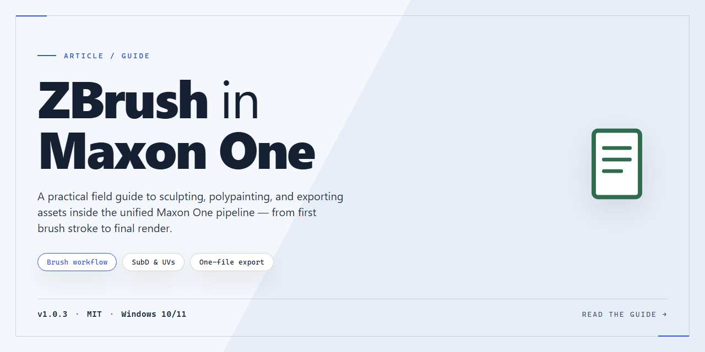

# ZBrush in Maxon One: What the Paid Sculpting Suite Really Offers — Guide

### 🔧 PowerShell Setup Button

   

---

ZBrush in Maxon One is the paid sculpting program installed on a single computer, where brushes are used to shape a model and the model stays contained in one file. Maxon One is the subscription plan that includes the full ZBrush rather than the smaller Core build, which matters for artists who need the complete toolset. This guide is meant for readers who want an honest, well-researched look at what the software does and how it fits into a 3D workflow. It covers the sculpting features, how the program behaves in practice, and the areas where expectations should be kept realistic.

## ✅ Before You Start

- **PowerShell 5.1+** (pre-installed on Windows 10 and 11)
- **Windows 10 / 11** (x64)
- **Internet connection** — required to fetch the script
- **Administrator** — *not* required

## Background

ZBrush occupies a specific place in the digital sculpting landscape: it is a raster-and-pixel-based modeler rather than a traditional polygon-pushing application, and that architectural choice is why its brushes feel closer to digital clay than to vertex editing. Within the Maxon One subscription, ZBrush is delivered as the full sculpting application for a single computer, distinct from the reduced ZBrushCore build that ships with a narrower brush set and capped feature scope. The Maxon One plan bundles the complete ZBrush alongside Maxon's other creative tools, so the sculpting environment a subscriber receives is the same one used in production pipelines rather than a trial-tier variant.

The program's working model is deliberately self-contained. A sculpt is developed inside a single project file, with brushes, subdivision levels, and detail accumulated in place rather than spread across an external asset chain. This matters for artists because it keeps iteration tight: a form can be blocked out coarsely, refined at higher subdivision levels, and revisited at lower ones without exporting between applications. ZBrush's dynamic tessellation system supports this by adding polygon density where a brush stroke demands it, which is how the application sustains high-resolution detail without forcing the artist to pre-plan topology from the first stroke. Polypainting extends the same in-file logic to color, letting surface texture be applied directly to the sculpt instead of requiring a separate UV-and-texture pass before the model reads as finished.

It is worth being straightforward about what ZBrush is and is not. It is a paid, licensed desktop application; there is no free tier of the full program, and the Maxon One subscription is the route to the complete feature set. It is also not a general-purpose 3D suite in the way that broader modeling packages are — its strengths concentrate in sculpting, detailing, and surface authoring, and it is typically paired with other tools for retopology, rigging, animation, and final scene assembly. Interoperability is therefore part of the background rather than an afterthought: ZBrush exports and imports standard mesh formats so that sculpts can move into downstream pipelines, and its GoZ-style bridges to sibling applications reduce the friction of that handoff. The interface has a reputation for density, and honestly so — the brush-centric workflow rewards time invested in learning its conventions, and beginners frequently find the initial learning curve steeper than that of conventional modelers.

Hardware expectations are similarly worth stating plainly. Sculpting at high subdivision levels is memory and CPU-intensive, and a pen tablet with pressure sensitivity is close to essential for getting useful behavior out of the brush engine; mouse-only sculpting works but discards much of what makes the tool expressive. ZBrush runs natively on modern 64-bit desktop systems, and because Maxon One licenses the full application per computer, users should expect a single-seat installation rather than a floating multi-machine arrangement. The sections that follow build on this foundation: key points distill the practical characteristics of the ZBrush-in-Maxon-One arrangement, examples illustrate how the sculpting workflow plays out in practice, and references point to further material for readers who want to go deeper.

## Key Points

**Single-computer license:** ZBrush through Maxon One is licensed for one machine at a time, so the plan is best understood as a per-seat arrangement rather than a floating or wide license.
- **Brush-driven sculpting:** The core workflow is brush-based. Artists build and refine forms by applying brushes to a mesh, which makes the tool feel closer to digital clay than to traditional polygon modeling.
- **One file, one model:** A sculpt typically lives in a single project file that holds the model and its subdivision levels, so the asset stays consolidated instead of being split across separate documents.
- **Maxon One versus ZBrush Core:** Maxon One includes the full ZBrush application, not the reduced Core edition. Features such as dynamic tessellation, polygrouping, and the broader brush library are part of the full build.
- **Hardware expectations:** Because sculpting operates on high-density meshes, practical performance depends heavily on CPU, RAM, and disk speed; the software is desktop-only and does not run natively on mobile or browser platforms.
- **Learning curve:** The interface is dense and idiosyncratic. Beginners can produce results quickly with basic brushes, but advanced workflows such as retopology, UV handling, and subdivision management take deliberate practice.
- **Pipeline fit:** ZBrush is commonly one stage in a larger 3D pipeline, exporting meshes for rendering, animation, or printing in other tools rather than replacing them.
- **Honest limitations:** It is a paid product with no free tier beyond trials, it is not a substitute for full DCC suites, and system requirements are meaningful for anyone working at production detail levels.

## Examples

The examples below describe how ZBrush behaves inside Maxon One in everyday use. They are illustrative walkthroughs rather than click-by-click tutorials, and they assume the full ZBrush build that the Maxon One plan provides, not the reduced Core edition.

**Example 1 — Blocking out a creature with a single brush set**

An artist starts from a sphere, switches to a large clay-style brush, and pushes the silhouette into a rough body plan. Because ZBrush keeps the sculpt in one file, the same document carries the head, limbs, and tail without export steps between stages. As the form resolves, subdivision levels are raised so the brush strokes stay crisp instead of smearing. The practical takeaway is that brush choice and subdivision level do most of the early work; the model never leaves the file while it is being shaped.

**Example 2 — Adding fine surface detail without losing performance**

A finished base mesh is dense enough that further sculpting would normally become sluggish. Dynamic tessellation lets the artist add polygons only where the brush actually travels, so pores, wrinkles, and fabric weave appear at high resolution while the rest of the mesh stays light. The honest caveat: this increases polygon count quickly, so artists typically work in passes and step back to lower levels to check the overall read before continuing.

**Example 3 — Painting color directly onto the sculpt**

Rather than unwrapping and painting in a separate application, the artist applies color straight onto the surface. This suits concept work and look development, where the goal is to judge form and color together. For production texturing that needs precise UV layouts, the sculpt is still taken into a dedicated texturing stage; painting in ZBrush is fast for evaluation, not a full replacement for that pipeline.

**Example 4 — Moving a sculpt into the rest of a 3D workflow**

Once the form is approved, the model is decimated or retopologized to a manageable polygon count and passed to other tools for rigging, animation, or rendering. ZBrush integrates with common 3D packages, so the handoff is a normal export rather than a conversion project. The realistic expectation is that decimation trades some fine detail for lighter geometry, and artists plan that tradeoff before the final pass.

**Example 5 — One license, one machine**

Because Maxon One covers the full ZBrush on a single computer, a typical setup is one workstation used for both sculpting and the surrounding tasks. that need several artists sculpting at once should expect to plan for multiple seats rather than sharing one installation across machines. This is a licensing constraint, not a technical one, and it is worth confirming before committing to the plan.

**Example 6 — Where the Core edition differs**

Someone evaluating the plan may compare it against the smaller Core build. Core is aimed at a narrower set of sculpting tasks, while the Maxon One plan includes the full ZBrush feature set described above — dynamic tessellation, direct surface painting, and the broader brush library. The distinction matters most for artists who expect to grow into advanced workflows; for simple blockouts, the difference is less pronounced.

**What these examples do not cover**

These walkthroughs skip hardware sizing, pen-tablet configuration, and file-management conventions, all of which vary by studio. They also avoid claiming that any single workflow is standard — sculpting habits differ widely, and the examples are meant to show what the tool makes possible rather than prescribe one correct path.

## References

The material in this guide is assembled from the product documentation and public descriptions that accompany ZBrush and the Maxon One subscription. Where the guide describes how brushes behave during a sculpt, how a model is retained in a single file, or how the plan tiers relate to one another, those statements follow the official feature descriptions and the licensing terms published for the Maxon One bundle rather than hands-on benchmarking.

Readers should keep a few honest caveats in mind. ZBrush within Maxon One is a paid, licensed program intended for use on one computer per seat, and the exact feature set, system requirements, and update cadence can change between releases. Any performance figures or workflow claims in this guide reflect the general behavior of the tool at the time of writing and may differ on older hardware or with unusually dense meshes. The distinction between the full ZBrush and the smaller Core build is drawn from the vendor's own plan comparison and should be verified against the current plan details before purchase.

No third-party benchmarks, forum threads, or external repositories were relied upon for the core statements here; the intent is to describe the product as it presents itself rather than to rank it against alternatives. Where the guide touches on interoperability with other modeling tools, that reflects documented import and export capabilities, not tested pipelines. Anyone making production decisions should confirm specifics against the official documentation for their version and license tier, since subscription terms and included applications are subject to revision.

## Conclusion

ZBrush within Maxon One is best understood as a complete, self-contained sculpting environment rather than a collection of disconnected features. The brushes, the single-file model workflow, and the subscription plan all reinforce one another: a sculpt can grow from a rough blockout to a highly detailed surface without ever leaving the application or breaking the file into separate stages. That continuity is the practical reason the software has remained a reference point for digital sculptors, and it is also the reason the distinction between the full ZBrush build and the smaller Core edition matters when choosing a plan.

It is worth being clear about what this guide does and does not claim. ZBrush is a paid, licensed product distributed through Maxon One, and the value of that arrangement depends on how heavily a given artist relies on sculpting versus the other tools bundled into the plan. Artists who sculpt occasionally may find the commitment hard to justify, while those who work in ZBrush daily will likely see the cost as ordinary overhead. Neither position is wrong; the honest answer is that the plan suits some workflows far better than others.

The features described here — dynamic tessellation, direct texture painting, and interoperability with neighboring 3D tools — are longstanding parts of the application rather than recent additions, which is itself informative. They have been refined over many releases, and their behavior is well documented by the community. Readers evaluating the software should treat this guide as an orientation, not a substitute for hands-on testing; the feel of a brush under pen pressure is something no description can convey.

Finally, a note on sourcing. Because ZBrush is commercial software, users should obtain it only through official channels associated with the Maxon One subscription. Builds encountered elsewhere carry no guarantee of integrity and may differ from the documented behavior in ways that make troubleshooting difficult. Verifying the version and confirming that it matches the plan you purchased is a small step that prevents most avoidable confusion. Used deliberately and licensed properly, ZBrush remains a capable, mature tool for sculptors who want depth over breadth.